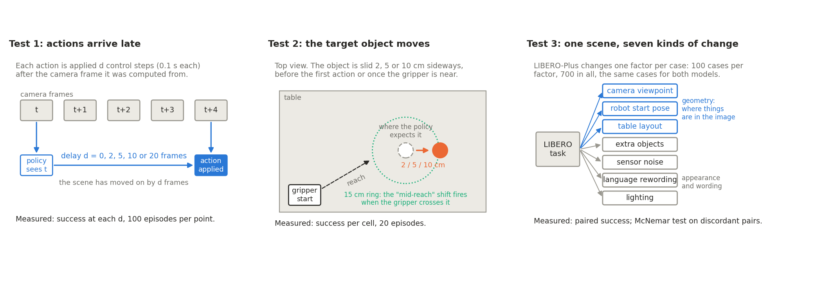
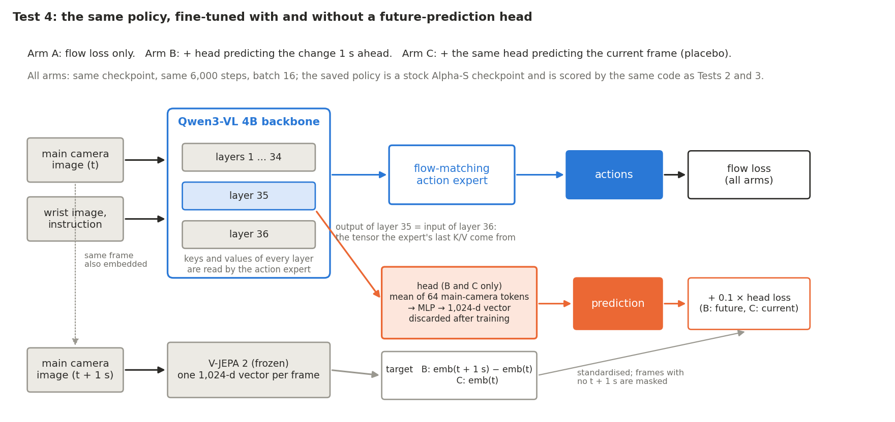
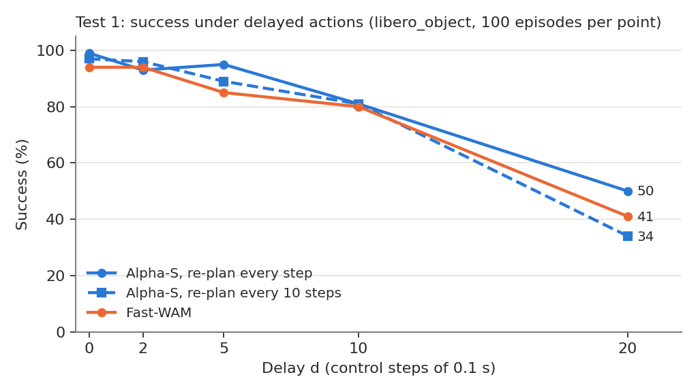
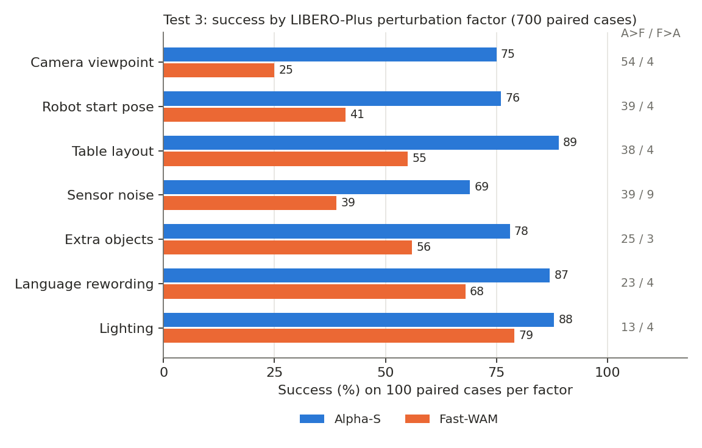
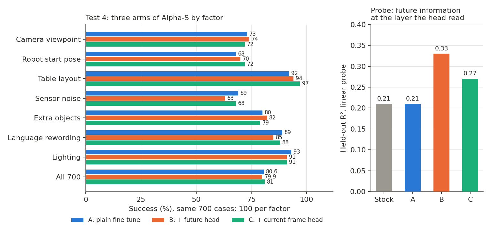

# Does world-action training make a robot policy more robust?

A paired stress test of two open-weight LIBERO policies, and a controlled follow-up on one of them.
Status as of 10 November 2026: all four tests complete.

**Summary.** On three stress tests in simulation, the world-action model Fast-WAM was no more robust
than Griffin's plain vision-language-action model Alpha-S. Under delayed actions the two degrade at
the same rate (Test 1). When the target object is moved 10 cm, Fast-WAM succeeds in 0–10% of
episodes and Alpha-S in 55–70% (Test 2). On 700 perturbed LIBERO-Plus cases evaluated for both
models, Alpha-S succeeds 80.3% of the time and Fast-WAM 51.9% (Test 3; 231 cases won by Alpha-S
alone against 32 by Fast-WAM alone). The deficit is largest when the geometry of the scene changes
(camera viewpoint: 25% vs 75%; robot start pose: 41% vs 76%) and smallest under lighting changes
(79% vs 88%). Because the two models differ in more than their training objective, Tests 1–3
compare models, not objectives. Test 4 isolates the objective: the same Alpha-S checkpoint is
fine-tuned three ways, plain (A), with a head that predicts the scene one second ahead (B), and
with the same head predicting the current frame (C), and each arm is scored on the same 700 cases.
The three arms tie: 80.6%, 79.9% and 81.0% (B vs A, p = 0.65), on the geometry factors too. The
head learned its target (cosine 0.59 to the true future embedding) and a linear probe finds the
future information in B's backbone at the layer the head read (R² 0.21 → 0.33), but the actions
did not change. At this budget, the world-action lesson altered the representation and not the
behaviour.

## 1. Question

World-action models (WAMs) train a policy to predict future observations alongside actions, on the
argument that a policy that models how the scene evolves should cope better when the scene departs
from the training distribution: late actions, moved objects, changed viewpoints. This repository
asks whether that holds for a WAM one can actually download, measured against a plain VLA on the
same tasks, the same simulator and the same cases.

Two policies, both trained on LIBERO and both at 94–100% on the standard LIBERO suites:

- **Alpha-S** — [griffinlabs/Griffin-Alpha-S-LIBERO](https://huggingface.co/griffinlabs/Griffin-Alpha-S-LIBERO).
  Qwen3-VL 4B backbone and a flow-matching action expert. No future prediction.
- **Fast-WAM** — [lerobot/fastwam_libero_uncond_2cam224](https://huggingface.co/lerobot/fastwam_libero_uncond_2cam224),
  from [arXiv 2603.16666](https://arxiv.org/abs/2603.16666). Trained with a world-action objective.
  The paper reports standard LIBERO only (no LIBERO-Plus numbers).

## 2. Design

Three stress tests on the released checkpoints, then one controlled experiment.

| Test | Stress | Sample | Statistic |
|---|---|---|---|
| 1 | Each action is applied d steps (0.1 s each) after the frame it was computed from, d ∈ {0, 2, 5, 10, 20} | libero_object, 100 episodes per point | success rate |
| 2 | The target object is slid 2, 5 or 10 cm sideways, before the first action or when the gripper first comes within 15 cm | libero_object, 20 episodes per cell | success rate |
| 3 | A [LIBERO-Plus](https://arxiv.org/abs/2510.13626) perturbation: camera viewpoint, robot start pose, table layout, extra objects, lighting, sensor noise or reworded instruction | 700 cases sampled across four suites, 100 per factor, one episode each, identical cases for both models | paired success; exact McNemar test on discordant pairs |
| 4 | Fine-tune Alpha-S 6,000 steps three ways: A stock; B plus a head predicting the V-JEPA 2 embedding of the main camera 1 s ahead (weight 0.1); C the same head predicting the current embedding | arms scored on Test 3's 700 cases and Test 2's 10 cm mid-reach shift | paired, as above |

Test 4's design. The head reads the input of the last backbone layer (the tensor the action
expert's last keys and values are computed from), so the lesson has to live where the expert can
see it; the head itself is thrown away after training.

Test 3's pairing matters: a 28-point gap on 700 shared cases is a different claim from a 28-point
gap on two independent samples. The per-factor breakdown (Section 3.3) was run after the overall
result was seen; it is reported as a hypothesis for Test 4, not a pre-registered finding.

Test 4's design choices are set out in [test4/README.md](test4/README.md), including why the head
reads the input of the last backbone layer, why the target is a *change* in embedding, and why arm C
exists (to separate "any auxiliary head helps" from "predicting the future helps").

## 3. Results

Full tables, including per-suite and per-suite-by-factor breakdowns, are in
[RESULTS.md](RESULTS.md) and [test3/analysis/breakdown-2026-11-09.txt](test3/analysis/breakdown-2026-11-09.txt).

### 3.1 Delayed actions (Test 1)

| Delay (steps) | 0 | 2 | 5 | 10 | 20 |
|---|---:|---:|---:|---:|---:|
| Fast-WAM | 94 | 94 | 85 | 80 | 41 |
| Alpha-S, re-plan every step | 99 | 93 | 95 | 81 | 50 |
| Alpha-S, re-plan every 10 steps | 97 | 96 | 89 | 81 | 34 |

The curves run together. No delay advantage for the world-action model.

### 3.2 Moved object (Test 2)

| Move | 2 cm | 5 cm | 10 cm |
|---|---:|---:|---:|
| At the start: Alpha-S / Fast-WAM | 100 / 95 | 95 / 70 | 70 / 10 |
| Mid-reach: Alpha-S / Fast-WAM | 100 / 100 | 80 / 60 | 55 / 0 |

With no move both score 100%. At 10 cm Fast-WAM collapses. Cells hold 20 episodes, so differences
under about 25 points are within noise; the 10 cm cells are not. A third mode, "blind" (camera frozen
after the move), scored 0% for both models at every size: it measured the frozen camera rather than
the move, and is dropped.

### 3.3 Perturbed scenes (Test 3)

700 paired cases, 100 per factor. "A>F" counts cases Alpha-S passed and Fast-WAM failed; "F>A" the reverse.

| What LIBERO-Plus changed | n | Alpha-S % | Fast-WAM % | Gap | A>F | F>A | p |
|---|---:|---:|---:|---:|---:|---:|---:|
| Camera viewpoint | 100 | 75.0 | 25.0 | 50.0 | 54 | 4 | <0.0001 |
| Robot start pose | 100 | 76.0 | 41.0 | 35.0 | 39 | 4 | <0.0001 |
| Table layout | 100 | 89.0 | 55.0 | 34.0 | 38 | 4 | <0.0001 |
| Sensor noise | 100 | 69.0 | 39.0 | 30.0 | 39 | 9 | <0.0001 |
| Extra objects | 100 | 78.0 | 56.0 | 22.0 | 25 | 3 | <0.0001 |
| Language rewording | 100 | 87.0 | 68.0 | 19.0 | 23 | 4 | 0.0003 |
| Lighting | 100 | 88.0 | 79.0 | 9.0 | 13 | 4 | 0.049 |
| All | 700 | 80.3 | 51.9 | 28.4 | 231 | 32 | <0.0001 |

By suite: Spatial 85.7 vs 51.4, Object 88.0 vs 71.4, Goal 70.3 vs 40.0, Long 77.1 vs 44.6 (175 cases each).
Fast-WAM scores 100% on 10 unperturbed LIBERO cases through the same code path, so the drop is the
perturbations, not the harness. Lighting is the one factor on which the models are close. The
three factors with the largest gaps (camera, start pose, layout) all change *where* things are in
the image; lighting changes only how they look.

### 3.4 Controlled test of the objective (Test 4)

All three arms trained for 6,000 steps (A: 2 h on an H100; B and C: 1.5 h each on an H200; 49 GB
peak). B's head learned the future target: loss 0.94 → 0.58, cosine to the true one-second-ahead
embedding 0.01 → 0.59 (the 500-step pilot had reached 0.20). C's head, predicting the current frame,
reached loss 0.08 and cosine 0.96. Each arm was then scored on Test 3's 700 cases and Test 2's
mid-reach shifts through the same code path as the stock model.

| Arm | Spatial | Object | Goal | Long | All 700 | 5 cm shift | 10 cm shift |
|---|---:|---:|---:|---:|---:|---:|---:|
| Stock Alpha-S | 85.7 | 88.0 | 70.3 | 77.1 | 80.3 | 80 | 55 |
| A: plain fine-tune | 83.4 | 87.4 | 74.3 | 77.1 | 80.6 | 85 | 60 |
| B: + future head | 85.7 | 83.4 | 74.9 | 75.4 | 79.9 | 85 | 65 |
| C: + current-frame head | 84.6 | 88.0 | 73.7 | 77.7 | 81.0 | 90 | 70 |

Paired comparisons on the 700 cases. Geometry = camera viewpoint, robot start pose and table
layout (300 cases); appearance = the other four factors (400).

| Comparison | Gap (points) | Wins | p |
|---|---:|---:|---:|
| B vs A, all | −0.7 | 36 / 41 | 0.65 |
| B vs A, geometry | +1.7 | 21 / 16 | 0.51 |
| B vs A, appearance | −2.5 | 15 / 25 | 0.15 |
| C vs A, all | +0.4 | 41 / 38 | 0.82 |
| C vs A, geometry | +2.7 | 26 / 18 | 0.29 |
| B vs C, all | −1.1 | 34 / 42 | 0.42 |
| A vs stock, all | +0.3 | 50 / 48 | 0.92 |

No factor reaches p < 0.2 for B vs A (full tables: [test4/analysis/breakdown-2026-11-10.txt](test4/analysis/breakdown-2026-11-10.txt)).
Of the 84 comparisons the script prints, one is nominally below 0.05 (B vs C on the Object suite,
p = 0.039), about what chance yields at that count. A ties the stock checkpoint, so the fine-tuning
itself is neutral and A is a fair baseline.

**Probe.** A ridge regression from each checkpoint's frozen backbone features (main-camera tokens,
held-out episodes) to the one-second-ahead change in the V-JEPA 2 embedding, the quantity B's head
was trained on ([test4/analysis/probe-2026-11-10.txt](test4/analysis/probe-2026-11-10.txt)):

| Checkpoint | Layer the head read: R² / cos | Layer 17: R² / cos |
|---|---:|---:|
| Stock | 0.21 / 0.44 | 0.27 / 0.50 |
| A | 0.21 / 0.43 | 0.27 / 0.50 |
| B | 0.33 / 0.50 | 0.29 / 0.51 |
| C | 0.27 / 0.46 | 0.27 / 0.50 |

The current-frame embedding is decodable from every checkpoint at R² 0.84–0.89.

## 4. What we expect from Test 4, stated before the arms run

- If future prediction is what makes a policy robust, arm B beats arm A on the geometry factors of
  Test 3 (camera, start pose, layout) and on the 10 cm mid-reach shift, and arm C does not.
- If any auxiliary visual head helps, B and C both beat A.
- If the 6,000-step budget is too short for the head to change the backbone, all three tie; the
  probe (`test4/probe.py`) then tells us whether the lesson reached the backbone at all.

Arms are evaluated on the stress tests rather than standard LIBERO because Alpha-S already scores
97–99% there: no headroom, so no test.

### 4.1 What happened

The third outcome: all three arms tie, overall and on the geometry factors. The probe adds the
useful part. B's backbone carries more information about the future at the layer the head read
(R² 0.21 → 0.33, no change for A) and a trace of it at layer 17, yet B's actions are no more robust
under a moved camera, robot or object. The lesson changed the representation and not the
behaviour: the action expert either does not use the information or 6,000 steps were too few for
it to learn to. Power: 77 discordant pairs between B and A would have shown a true gap of about 3
points at p < 0.05; smaller effects are not excluded. Set against Tests 1–3, where the released
WAM trails the plain VLA by 28 points on these cases, the controlled result says the objective, in
this form, moves robustness by at most a few points either way; the 28-point gap between the two
released models comes from everything else that differs between them.

## 5. Threats to validity

- **Construct.** Tests 1–3 compare two models that differ in backbone, size, image resolution,
  training data and action chunking. They show that *this* WAM is less robust than *this* VLA; they do
  not show that the world-action objective hurts. Test 4 is the controlled comparison.
- **Internal.** Test 3 runs one episode per case with fixed seeds; a case's outcome is a single
  Bernoulli draw. The pairing and the discordant-pair counts carry the inference, not the
  per-case outcomes. Test 2's shift logic is checked by unit tests (`test2/test_shift_logic.py`) and
  an AST comparison of its rollout loop against Test 1's.
- **Conclusion.** Test 2 cells are 20 episodes. Test 3's factor breakdown is post hoc. McNemar
  p-values are exact two-sided binomial; no multiplicity correction is applied across the 7 factors,
  though 6 of 7 survive one at 0.05/7 and the ranking was unchanged between the 656-case and the
  700-case analyses.
- **Test 4 specifically.** One seed per arm; 6,000 steps; head weight 0.1; a single-camera,
  one-second-ahead V-JEPA 2 embedding as target. That is a narrow form of world modelling (no
  multi-step rollout, no pixel generation, no conditioning on the candidate action), and the
  fine-tuning data contains none of the perturbations the arms are scored on, so the test asks
  whether the lesson transfers, not whether training on perturbations helps. A different head,
  horizon or budget could behave differently.
- **External.** Simulation only (MuJoCo via robosuite), LIBERO tasks only, one checkpoint per
  model. The Fast-WAM checkpoint was run with the inputs its card specifies (two 224 px cameras);
  no attempt was made to tune it for the perturbed conditions.

## 6. Repository

| Folder | Contents |
|---|---|
| [test1](test1) | `eval_delay.py`: LeRobot's LIBERO eval with a delay buffer; `eval_delay.patch` against the stock script |
| [test2](test2) | `eval_shift.py`: the same loop with the object shift; `README.md` explains the shift geometry; Slurm pilot scripts |
| [test3](test3) | Slurm jobs over the fixed 700-case sample (`t3_selection.json`); `analysis/` holds the name dump, the paired breakdown script and its 9 Nov outputs |
| [test4](test4) | Training entry point, head, targets, probe, unit tests and Slurm jobs; its own README; `t4break.py` and `analysis/` hold the paired arm comparison and probe outputs |
| [RESULTS.md](RESULTS.md) | All result tables in one place |
| [figures](figures) | The figures above: `make_diagrams.py` draws the two schematics, `make_figures.py` renders the three result charts from the numbers in RESULTS.md |

Each `*.sh` is a Slurm job as run on a university cluster, one H100/H200/A100 per job. Environments:
LeRobot 0.6.1 with Griffin's [alpha-s](https://github.com/griffinlabs-ai/alpha-s) plugin for Alpha-S;
LeRobot 0.6.1 for Fast-WAM; LIBERO-Plus from [sylvestf/LIBERO-plus](https://github.com/sylvestf/LIBERO-plus)
for Test 3. Every number above is read from the `eval_info.json` each job writes.
